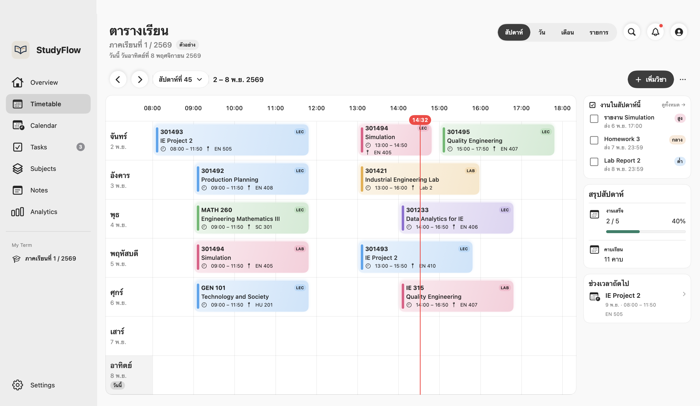

# StudyFlow Planner

ตัวจัดตารางเรียนและงานที่แยกข้อมูลตามเทอม ดูตารางครบ 7 วัน เช็กงานที่ใกล้ส่ง และแชร์เฉพาะหมวดที่เลือกได้ ซิงก์ชุดข้อมูลด้วยโค้ดโดยไม่ต้องสร้างบัญชี StudyFlow

## มีอะไรในรุ่น 1.1.0

- ธีม Soft Honey และ White / Lilac เลือกได้จาก Settings
- เพิ่มหรือแก้คาบเรียนจากการ์ดบนตาราง และเปิดฟอร์มเพิ่มวิชา งาน หรือกิจกรรมเป็นป๊อปอัป
- เว็บและ Windows ใช้ Noto Sans Thai ที่มากับแอปสำหรับภาษาไทยและอังกฤษ เว็บเก็บฟอนต์ไว้ในแคชเพื่อใช้ตอนออฟไลน์

## ดาวน์โหลด

เปิดแท็บ **Releases** ของ GitHub แล้วเลือกไฟล์ตามระบบ

| ระบบ | ไฟล์ | วิธีใช้ |
| --- | --- | --- |
| macOS 14 ขึ้นไป · Apple Silicon และ Intel | `StudyFlow-macOS-Universal.zip` | แตก ZIP แล้วเปิด `StudyFlow Planner.app` |
| Windows 10 / 11 · x64 | `StudyFlow-Windows-x64.zip` | แตก ZIP ทั้งโฟลเดอร์ แล้วเปิด `StudyFlow Planner.exe` ต้องมี .NET Framework 4.8 และ [Microsoft Edge WebView2 Runtime](https://developer.microsoft.com/microsoft-edge/webview2/#download-section) |
| iPhone / iPad | [StudyFlow Web](https://suanaph-studyflow-planner.netlify.app/) | เปิดผ่าน Safari → แชร์ → เพิ่มไปยังหน้าจอโฮม แล้วเริ่มใช้ได้ทันที |

รุ่น macOS นี้ใช้ลายเซ็น ad hoc และยังไม่ได้ notarize จึงอาจถูก Gatekeeper บล็อกเมื่อดาวน์โหลดผ่านเบราว์เซอร์ รุ่น Windows ยังไม่มีลายเซ็น Authenticode และยังต้องทดสอบบน Windows จริง ไฟล์ macOS ในชุดนี้เป็นแอป SwiftUI แบบสแตนด์อโลน ส่วนรุ่นที่มี Mac Widget ใช้ scheme **StudyFlow Mac** ใน Xcode พร้อม App Groups ของผู้สร้าง

## ซิงก์และแชร์

- ในแอป Mac เปิด **Settings → ซิงก์ด้วยโค้ด** ปิดโหมดตัวอย่างก่อน แล้วสร้างหรือคัดลอกโค้ดส่วนตัว ใช้โค้ดนี้บนเครื่องของตัวเองเพื่อดูและแก้ชุดข้อมูลเดียวกัน
- ถ้าจะแชร์ให้คนอื่นดู ให้ใช้ปุ่มแชร์ในหน้าตาราง เลือกตารางกับวิชา งาน หรือกิจกรรม แล้วส่งโค้ดแชร์และรหัสให้ผู้รับ
- เว็บเปิดมาที่ตารางในเครื่องทันทีและใช้โค้ดเฉพาะตอนอยากซิงก์ Windows และเว็บเริ่มจัดตารางในเครื่องได้เลย หลังเชื่อมออนไลน์ครั้งแรกจะเก็บข้อมูลของชุดซิงก์แบบเข้ารหัสไว้ในเครื่อง เปิดด้วยโค้ดเดิมตอนออฟไลน์ได้ ระบบส่งงานที่แก้เมื่อแอปออนไลน์อีกครั้ง
- Apple Watch รับข้อมูลจากแอป iPhone แบบ native ที่จับคู่ผ่าน Watch Connectivity

## สร้างจากซอร์ส

**macOS** ใช้ Swift 6 และ Xcode Command Line Tools แล้วรัน `./build-swift.sh` จากราก repo หรือเปิด `StudyFlow Planner.xcodeproj` ใน Xcode สำหรับแอปที่มีวิดเจ็ต

**Windows x64** ใช้ .NET SDK แล้วรัน `dotnet build Windows/StudyFlow.Windows.csproj -c Release -p:Platform=x64` ผลลัพธ์อยู่ที่ `Windows/bin/x64/Release/net48/` เก็บไฟล์และโฟลเดอร์ข้าง EXE ไว้ด้วย

ซอร์สเวอร์ชันนี้มีค่า Supabase ว่างสำหรับตั้งค่าเอง แอป Mac ใช้ข้อมูลในเครื่องได้ทันที ส่วน Windows และเว็บเปิดใช้ในเครื่องได้ทันที และตั้ง Project URL กับ Publishable Key ใน `Cloud/Web/config.mjs` เมื่อต้องการเชื่อมคลาวด์ ดู [วิธีตั้งค่า](Cloud/SETUP.md)

ทดสอบด้วย `swift test` และ `node --test Cloud/Tests/*.test.mjs`

## จัดไฟล์บน GitHub

ใช้ไฟล์ใน `Source` เป็นราก repository แล้วแนบ ZIP สำหรับ macOS และ Windows เป็น assets ใน GitHub Release เวอร์ชันเดียวกัน ดู [วิธีสร้าง GitHub Release](https://docs.github.com/en/repositories/releasing-projects-on-github/managing-releases-in-a-repository)

อ่านเรื่อง [การลงนามและ notarize แอป macOS](https://developer.apple.com/documentation/security/notarizing-macos-software-before-distribution) ก่อนเผยแพร่รุ่นติดตั้งทั่วไป
